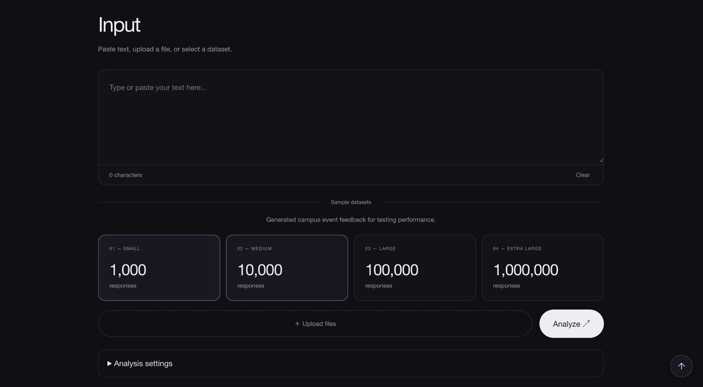
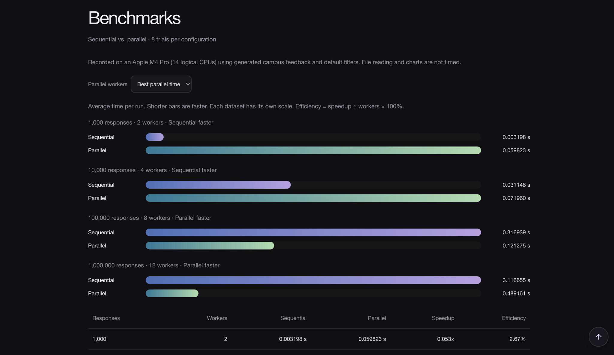

# wordly.

**Find meaning in repetition.**

A local word frequency analyzer built for Parallel and Distributed Computing — Laboratory. Wordly analyzes text and documents, visualizes word counts, and compares actual sequential and parallel Python execution.


## Features

- Paste text, upload documents, or choose generated campus feedback datasets.
- Filter common words, custom words, numbers, case, and word length; count individual words or phrases.
- Explore a frequency curve, bubble map, word cloud, and frequency bars.
- Search and sort word counts, inspect matching text, compare documents, and export results.
- Measure sequential and parallel execution time, speedup, efficiency, and count agreement.

## Preview

### Input



### Frequency analysis


### Word map


## Tech stack

Python · Flask · HTML · CSS · JavaScript · `concurrent.futures.ProcessPoolExecutor`

## Setup

Python 3.9 or later. From the project directory:

```sh
python3 -m venv .venv
source .venv/bin/activate
python -m pip install -r requirements.txt
python generate_dataset.py
python app.py
```

Open http://127.0.0.1:5000. The server is intended for local use only. For the original console application, run `python main.py`. Generate datasets only if they are missing; generation is reproducible with seed 42.

## Implementation

- `analyzer.py`: original two-worker baseline, ASCII word extraction, fixed stop-word list, Counter and ProcessPoolExecutor.
- `benchmark.py`: original experiment, with future runs stored separately under `results/runs/`.
- `advanced_analyzer.py`: configurable Unicode-aware analysis. Both methods split lines into the same chunks, count independently and merge counters. Parallel runs use separate Python processes, not threads. Stemming and case sensitivity are mutually exclusive.
- `file_reader.py`: extracts text from supported documents.
- `app.py`: local Flask API; `templates/` and `static/` provide the interface.

## Usage and limitations

Paste text, choose a sample dataset or upload up to ten files. TXT and Markdown use UTF-8; PDF requires extractable text (no OCR); DOCX reads paragraphs and tables; CSV and XLSX assume the first row contains headers, XLSX reads the active sheet and cached formula values; JSON reads string values, not keys or numeric values. Spreadsheet columns may be selected. Each nonempty line or cell is an independent unit. Word phrases do not cross lines or skipped words; punctuation is treated as a separator, not a sentence boundary. English stemming is not lemmatization. Minimum count only filters displayed/exported frequencies; statistics and correctness checks use the full counts. Context search matches exact counted words or phrases within the first 10,000 lines, truncated to 2,000 characters each, and returns at most 100 lines. The PNG export saves the frequency curve; CSV exports the searched/sorted table, JSON exports the result list. Recent history stores dates, line counts and speedup locally, not document text.

Requests are limited to 100 MiB, 10 uploaded files, 1.1 million nonempty lines and 60 million extracted characters. ZIP-based documents have an additional 150 MiB uncompressed size check. These are practical limits, not a guarantee against resource exhaustion; use trusted local files. No public deployment is intended.

## Performance methodology

| Feedback entries | Mean sequential (s) | Mean parallel (s) | Speedup | Efficiency |
|---:|---:|---:|---:|---:|
| 1,000 | 0.001357 | 0.042623 | 0.0318× | 1.59% |
| 10,000 | 0.012679 | 0.049510 | 0.2561× | 12.80% |
| 100,000 | 0.132276 | 0.119661 | 1.1054× | 55.27% |
| 1,000,000 | 1.325495 | 0.789387 | 1.6791× | 83.96% |



The archived CSV files in `results/` are the original two-worker baseline, not timings of the configurable web engine. Four synthetic datasets (1,000; 10,000; 100,000; 1,000,000 lines) were tested in ten paired trials each, alternating execution order. Timing includes chunk creation, counting, process startup, transfer, merging and shutdown; excludes input reading, extraction, UI and output. Speedup = mean sequential time / mean parallel time; efficiency = speedup / worker count × 100%. Efficiency is not CPU utilization. All 40 paired trials agreed on complete frequency counters. Results are device- and workload-specific. 

## Tests

```sh
python test_advanced.py
python test_final.py
python test_reliability.py
python test_web.py
python test_word_statistics.py
```

The last command requires Flask. Browser checks: analyze pasted text, sample data and files; verify counts and charts, comparison, downloads, history, keyboard controls and mobile layout. 

## Final documentation note

The original proposal excluded a graphical interface. The delivered application adds an optional local web interface while preserving the original console implementation and experimental method.

The Words excluded statistic counts input units removed by word filters before phrase grouping. Numeric runs are counted separately as excluded units when numbers are disabled; minimum count only filters displayed results. These statistics are calculated outside the timed processing comparison.
