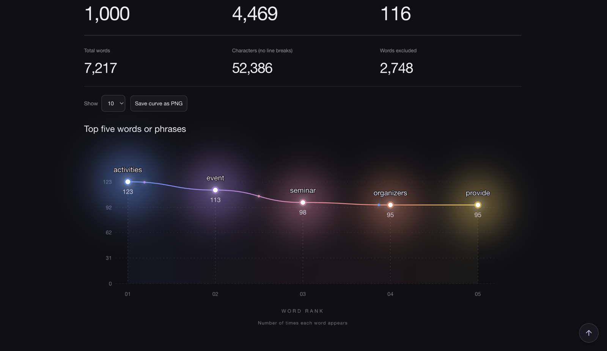
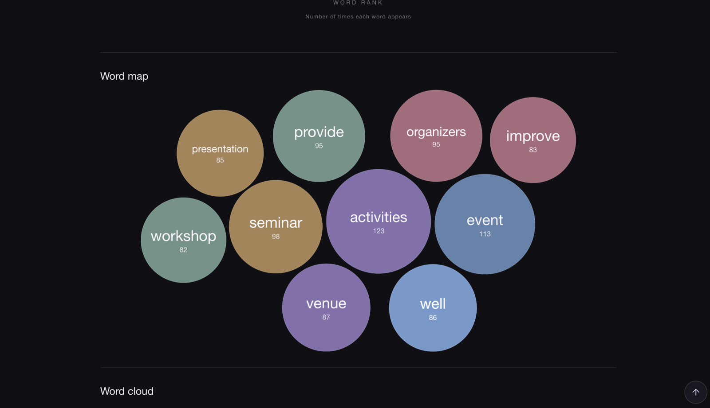

# wordly.

**Find meaning in repetition.**

A local word frequency analyzer built for Parallel and Distributed Computing — Laboratory. Wordly analyzes text and documents, visualizes word counts, and compares actual sequential and parallel Python execution, with an optional network-based coordinator–worker mode. The research evaluation focuses on sequential and local parallel computing; the network mode is an optional extension tested on loopback only.


## Features

- Paste text, upload documents, or choose generated campus feedback datasets.
- Filter common words, custom words, numbers, case, and word length; count individual words or phrases.
- Explore a frequency curve, bubble map, word cloud, and frequency bars.
- Search and sort word counts, inspect matching text, compare documents, and export results.
- Measure sequential and parallel execution time, speedup, efficiency, and count agreement.
- Choose 2–14 local worker processes (subject to the host CPU limit), or use machine-specific benchmark-based automatic selection.
- Compare local execution against authenticated HTTP worker services, with automatic batching and count verification.

## Preview

### Input


### Frequency analysis



### Word map



## Tech stack

Python · Flask · HTML · CSS · JavaScript · `concurrent.futures.ProcessPoolExecutor`

## Setup

Python 3.9 or later. From the project directory:

```sh
python3 -m venv .venv
source .venv/bin/activate
python -m pip install -r requirements.txt
python generate_dataset.py
python app.py
```

Open http://127.0.0.1:5000. The server is intended for local use only. For the original console application, run `python main.py`. Generate datasets only if they are missing; generation is reproducible with seed 42.

## Implementation

- `analyzer.py`: original two-worker baseline, ASCII word extraction, fixed stop-word list, Counter and ProcessPoolExecutor.
- `benchmark.py`: original experiment, with future runs stored separately under `results/runs/`.
- `advanced_analyzer.py`: configurable Unicode-aware analysis. Both methods use the same counting logic and merge chunk counters. Sequential runs use two chunks processed serially; parallel runs use the selected number of worker processes. Parallel runs use separate Python processes, not threads. Stemming and case sensitivity are mutually exclusive.
- `file_reader.py`: extracts text from supported documents.
- `app.py`: local Flask API; `templates/` and `static/` provide the interface.
- `distributed.py`, `distributed_web.py`, `worker.py`: network task assignment, bounded JSON batches, remote counting and aggregation.
- `benchmark_scaling.py`, `worker_policy.py`: supplementary scaling experiments and machine-specific calibration.

## Usage and limitations

Paste text, choose a sample dataset or upload up to ten files. TXT and Markdown use UTF-8; PDF requires extractable text (no OCR); DOCX reads paragraphs and tables; CSV and XLSX assume the first row contains headers, XLSX reads the active sheet and cached formula values; JSON reads string values, not keys or numeric values. Spreadsheet columns may be selected. Each nonempty line or cell is an independent unit. Word phrases do not cross lines or skipped words; punctuation is treated as a separator, not a sentence boundary. English stemming is not lemmatization. Minimum count only filters displayed/exported frequencies; statistics and correctness checks use the full counts. Context search matches exact counted words or phrases within the first 10,000 lines, truncated to 2,000 characters each, and returns at most 100 lines. The PNG export saves the frequency curve; CSV exports the searched/sorted table, JSON exports the result list. Recent history stores dates, line counts and speedup locally, not document text.

Requests are limited to 100 MiB, 10 uploaded files, 1.1 million nonempty lines and 60 million extracted characters. ZIP-based documents have an additional 150 MiB uncompressed size check. These are practical limits, not a guarantee against resource exhaustion; use trusted local files. No public deployment is intended.

## Performance methodology

| Feedback entries | Mean sequential (s) | Mean parallel (s) | Speedup | Efficiency |
|---:|---:|---:|---:|---:|
| 1,000 | 0.001357 | 0.042623 | 0.0318× | 1.59% |
| 10,000 | 0.012679 | 0.049510 | 0.2561× | 12.80% |
| 100,000 | 0.132276 | 0.119661 | 1.1054× | 55.27% |
| 1,000,000 | 1.325495 | 0.789387 | 1.6791× | 83.96% |


The archived CSV files in `results/` are the original two-worker baseline, not timings of the configurable web engine. Four synthetic datasets (1,000; 10,000; 100,000; 1,000,000 lines) were tested in ten paired trials each, alternating execution order. Timing includes chunk creation, counting, process startup, transfer, merging and shutdown; excludes input reading, extraction, UI and output. Speedup = mean sequential time / mean parallel time; efficiency = speedup / worker count × 100%. Efficiency is not CPU utilization. All 40 paired trials agreed on complete frequency counters. Results are device- and workload-specific. Synthetic feedback uses a limited set of templates, not actual survey responses. No distributed machines were used in this original baseline experiment. The web interface was added after the baseline experiment and has additional settings; live results are single-run measurements, not the archived averages.

## Supplementary scaling experiment (v3.3)

Eight trials per configuration, rotating execution order, on an Apple M4 Pro with 14 logical CPUs. The configurable analysis engine was used with default filters; these measurements are separate from the original baseline.

| Workers | 1,000 (s) | 10,000 (s) | 100,000 (s) | 1,000,000 (s) |
|---:|---:|---:|---:|---:|
| Sequential | 0.003198 | 0.031148 | 0.316939 | 3.116655 |
| 2 | 0.059823 | 0.075488 | 0.225166 | 1.758814 |
| 4 | 0.063365 | 0.071960 | 0.151867 | 0.957569 |
| 6 | 0.069243 | 0.075076 | 0.127943 | 0.692296 |
| 8 | 0.077855 | 0.079506 | 0.121275 | 0.569872 |
| 10 | 0.087428 | 0.087455 | 0.121898 | 0.514616 |
| 12 | 0.102038 | 0.102764 | 0.144936 | 0.489161 |
| 14 | 0.119322 | 0.119899 | 0.152439 | 0.489337 |

Twelve workers achieved the lowest measured mean time on one million responses (0.489161 s, 6.37× speedup); fourteen workers were effectively tied (0.489337 s). Sequential execution was fastest for the two smaller datasets. The automatic option selects the fastest measured *parallel* configuration for a nearby sample size and reports when sequential was faster. Both methods still execute for comparison. Calibration is specific to the host and default filters, not a general optimization guarantee.

See [supplementary benchmark data](results/published/README.md). To calibrate your own machine, choose worker counts appropriate to its CPU limit:

```sh
python benchmark_scaling.py --trials 8 --calibrate
```

## Network processing

The coordinator partitions nonempty input lines among configured worker endpoints and sends batches of up to 4 MiB of JSON. Each worker independently counts words and returns a counter; the coordinator merges these counters and compares them with sequential and local parallel results. Requests are authenticated with a shared token, but HTTP is not encrypted.

Local loopback tests passed at all four sample sizes (the million-line test passed after batching, using 14 requests across two worker services). These services ran on one physical Mac. This validates network communication and aggregation, not physical multi-computer performance. Physical multi-device testing and formal distributed benchmarking are outside the current project scope.

For optional future work, see [worker setup and benchmark procedure](docs/distributed-testing.md). Do not expose worker ports to the public internet or transmit sensitive text.

## Tests

```sh
python test_advanced.py
python test_final.py
python test_reliability.py
python test_web.py
python test_word_statistics.py
python test_distributed.py
python test_batching.py
python test_worker_policy.py
```

The web test requires Flask. Browser checks: analyze pasted text, sample data and files; verify counts and charts, comparison, downloads, history, keyboard controls and mobile layout. Do not treat syntax checks as browser tests.

## Final documentation note

The original proposal excluded a graphical interface. The delivered application adds an optional local web interface and an experimental network processing mode while preserving the original console implementation and experimental method. State this scope change in the final paper and confirm any required instructor approval.

The Words excluded statistic counts input units removed by word filters before phrase grouping. Numeric runs are counted separately as excluded units when numbers are disabled; minimum count only filters displayed results. These statistics are calculated outside the timed processing comparison.
