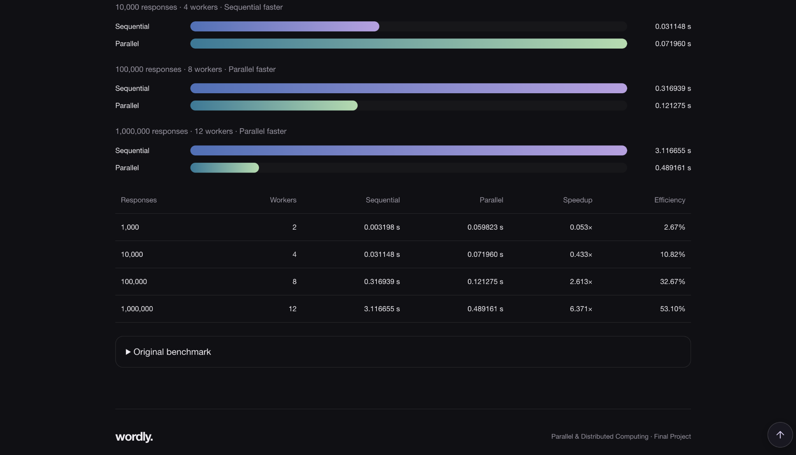
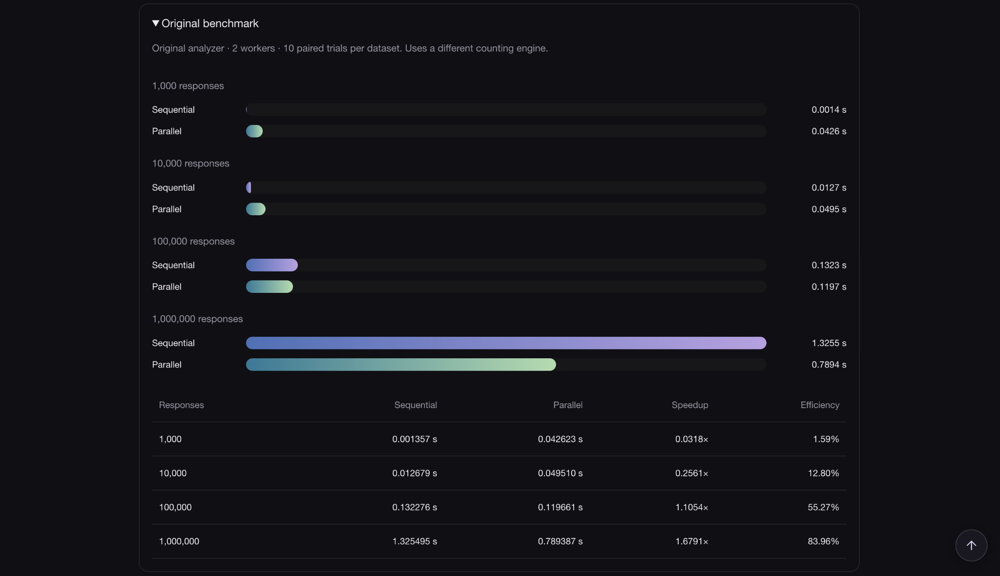
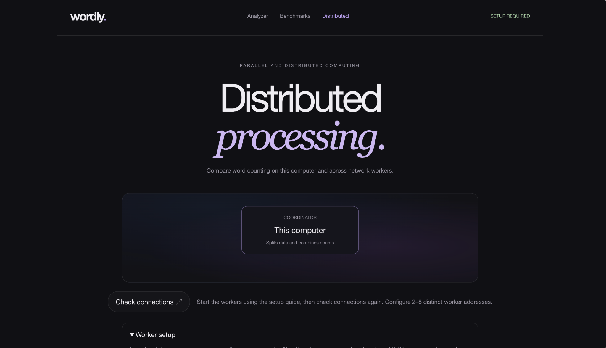

# wordly.

**Find meaning in repetition.**

A local word frequency analyzer built with Python and Flask for a Parallel and Distributed Computing laboratory project. Analyze text and documents, explore word frequencies, and compare sequential and parallel execution. An optional network mode connects to HTTP worker services.


## Features

- Paste text, upload documents, or use generated campus feedback datasets.
- Filter common words, custom words, numbers, case, and word length; count words or phrases.
- View frequency curves, word maps, word clouds, bar charts, and searchable frequency tables.
- Compare documents, find words in context, and export CSV, JSON, or a PNG of the frequency curve.
- Compare actual execution times, speedup, efficiency, and word-count agreement.
- Select 2–14 parallel processes, subject to the host's CPU limit, or use automatic worker selection.
- Browse recorded benchmarks by worker count and access the original benchmark separately.
- Connect to network workers through the optional Distributed page.

## Getting started

Python 3.9 or later. The following commands are for macOS and Linux:

```sh
git clone https://github.com/isephin/wordly.git
cd wordly
python3 -m venv .venv
source .venv/bin/activate
python -m pip install -r requirements.txt
python generate_dataset.py
python app.py
```

Open [http://127.0.0.1:5000](http://127.0.0.1:5000). The application runs locally; no network workers are needed for the Analyzer. Generate the sample datasets only if they are missing. The original console program is available with `python main.py`.

### Analyzer

Select a sample dataset, paste text, or upload files. Expand **Analysis settings** to change filters, phrase length, and parallel worker count. Click **Analyze** to run both sequential and parallel methods.


<details>
<summary>Word map</summary>


</details>

Supported formats: TXT, Markdown, PDF (selectable text), DOCX, CSV, XLSX, and JSON. Up to ten files can be uploaded at a time.

## Benchmarks

The current Analyzer uses the configurable word-counting engine. The Benchmarks section displays recorded averages for sequential execution and 2, 4, 6, 8, 10, 12, or 14 parallel processes. Select a worker count or **Best parallel time** to compare the fastest recorded parallel configuration for each dataset.


### Current analyzer results

Apple M4 Pro · 14 logical CPUs · 24 GB RAM · Python 3.9.6 · 8 trials per configuration · default filters.

| Responses | Workers | Sequential (s) | Parallel (s) | Speedup | Efficiency |
|---:|---:|---:|---:|---:|---:|
| 1,000 | 2 | 0.003198 | 0.059823 | 0.053× | 2.67% |
| 10,000 | 4 | 0.031148 | 0.071960 | 0.433× | 10.82% |
| 100,000 | 8 | 0.316939 | 0.121275 | 2.613× | 32.67% |
| 1,000,000 | 12 | 3.116655 | 0.489161 | 6.371× | 53.10% |

Sequential execution was faster on the two smaller datasets. At one million responses, 12 workers achieved the lowest recorded mean time, about 6.37× faster than sequential execution. The 14-worker result (0.489337 s) was nearly identical. All 256 timed measurements matched the reference word counts.

<details>
<summary>Full scaling results and benchmark table</summary>

Mean execution time in seconds:

| Workers | 1,000 | 10,000 | 100,000 | 1,000,000 |
|---:|---:|---:|---:|---:|
| Sequential | 0.003198 | 0.031148 | 0.316939 | 3.116655 |
| 2 | 0.059823 | 0.075488 | 0.225166 | 1.758814 |
| 4 | 0.063365 | 0.071960 | 0.151867 | 0.957569 |
| 6 | 0.069243 | 0.075076 | 0.127943 | 0.692296 |
| 8 | 0.077855 | 0.079506 | 0.121275 | 0.569872 |
| 10 | 0.087428 | 0.087455 | 0.121898 | 0.514616 |
| 12 | 0.102038 | 0.102764 | 0.144936 | 0.489161 |
| 14 | 0.119322 | 0.119899 | 0.152439 | 0.489337 |



</details>

[Scaling data and methodology](results/published/README.md) · [Trial results](results/published/scaling_v3_3_raw.csv) · [Summary](results/published/scaling_v3_3_summary.csv)

The datasets contain synthetic campus event feedback generated from a limited set of templates using seed 42. The experiment rotates execution order and starts a fresh process pool for each parallel run. Timing includes chunk creation, counting, process coordination and merging; file reading, text extraction and visualizations are excluded. Speedup is mean sequential time divided by mean parallel time. Efficiency is speedup divided by worker count × 100%; it is not CPU utilization.

The published scaling CSVs were reconstructed from console timings rounded to six decimal places. Derived values may differ slightly from the original full-precision local CSVs. Live analysis times are single-run measurements and will vary by machine, workload and filters.

<details>
<summary>Original two-worker benchmark</summary>

The initial experiment used the simpler counting engine in `analyzer.py`, with ten paired trials per dataset and alternating execution order. All 40 pairs returned identical word counts. These results are retained separately because the two engines use different preprocessing implementations.

| Responses | Sequential (s) | Parallel (s) | Speedup | Efficiency |
|---:|---:|---:|---:|---:|
| 1,000 | 0.001357 | 0.042623 | 0.0318× | 1.59% |
| 10,000 | 0.012679 | 0.049510 | 0.2561× | 12.80% |
| 100,000 | 0.132276 | 0.119661 | 1.1054× | 55.27% |
| 1,000,000 | 1.325495 | 0.789387 | 1.6791× | 83.96% |



[Original benchmark summary](results/benchmark_summary.csv)

</details>

### Automatic worker selection

Automatic uses the fastest measured parallel configuration for the nearest sample size in a matching local calibration profile. It still runs both sequential and parallel processing. Without a matching profile, it uses two workers.

To generate a profile for your own computer (optional):

```sh
python benchmark_scaling.py --trials 8 --calibrate
```

Calibration is specific to the machine and default filters. It does not guarantee the fastest configuration for every input.

## Distributed processing

The optional Distributed page compares sequential, local parallel, and network-based counting. The coordinator splits input lines into batches, sends them to worker services, and merges the returned counters. Requests use a shared token. The coordinator checks whether all three methods produce identical counts.



### Local worker setup

Open three terminals in the project folder. Use the virtual environment and dependencies installed above. Stop any existing Wordly server before starting the coordinator.

**Terminal 1 — Worker 1**

```sh
source .venv/bin/activate
export WORDLY_TOKEN="wordly-local-demo-test-secret"
python worker.py --host 127.0.0.1 --port 8765
```

**Terminal 2 — Worker 2**

```sh
source .venv/bin/activate
export WORDLY_TOKEN="wordly-local-demo-test-secret"
python worker.py --host 127.0.0.1 --port 8766
```

**Terminal 3 — Coordinator**

```sh
source .venv/bin/activate
export WORDLY_TOKEN="wordly-local-demo-test-secret"
export WORDLY_WORKERS="http://127.0.0.1:8765,http://127.0.0.1:8766"
python app.py
```

Open [http://127.0.0.1:5000/distributed](http://127.0.0.1:5000/distributed), click **Check connections**, and confirm both workers are online. Select a sample dataset and click **Analyze**. If a worker is offline, check its port, token, and terminal. Stop the services with `Ctrl+C` when finished.

Network processing was tested using two worker services on one physical Mac (loopback), including a million-line workload. This validates HTTP communication and aggregation, not performance across physical computers. The formal evaluation focuses on local parallel processing. Network workers are already running when timed, unlike fresh local process pools.

The example token is for loopback testing only. For a trusted LAN, use a private shared token. HTTP is not encrypted; do not send sensitive text or expose worker ports publicly. [Optional LAN setup](docs/distributed-testing.md).

## Implementation

Python · Flask · HTML · CSS · JavaScript · `concurrent.futures.ProcessPoolExecutor` · `collections.Counter`

| File | Purpose |
|---|---|
| `analyzer.py`, `main.py` | Original two-worker analyzer and console program |
| `advanced_analyzer.py` | Configurable Unicode-aware counting and filters |
| `file_reader.py` | Document text extraction |
| `app.py`, `templates/`, `static/` | Flask API and browser interface |
| `generate_dataset.py` | Reproducible sample datasets |
| `benchmark.py` | Original benchmark |
| `benchmark_scaling.py`, `worker_policy.py` | Worker scaling and local calibration |
| `distributed.py`, `distributed_web.py`, `worker.py` | HTTP worker communication and count aggregation |

Both local methods use the same counting logic. Sequential processes two chunks serially; parallel splits the workload according to the selected worker count and uses separate Python processes. Partial counters are merged into the final frequencies.

## Limits and behavior

- Requests: 100 MiB, up to 10 files, 1.1 million nonempty lines, and 60 million extracted characters. ZIP-based documents have an additional 150 MiB uncompressed size check. Use trusted local files.
- PDF requires extractable text (no OCR). DOCX reads paragraphs and tables. CSV and XLSX use the first row as headers; XLSX reads the active sheet and cached formula values. JSON reads string values.
- Phrases do not cross lines or skipped words. Stemming and case sensitivity cannot be combined. Minimum count filters displayed/exported frequencies, not the total counts.
- Keyword context covers the first 10,000 lines, up to 2,000 characters per line and 100 matches. Recent analysis history stores dates, line counts, and speedup in the browser, not document text.
- CSV exports the searched/sorted table; JSON exports the result list; PNG exports the frequency curve. The excluded-word count includes units removed by word filters before phrase grouping, including disabled numeric runs.

## Tests

```sh
python test_advanced.py
python test_final.py
python test_reliability.py
python test_web.py
python test_word_statistics.py
python test_distributed.py
python test_batching.py
python test_worker_policy.py
```

The web test requires Flask. Browser checks include uploads, filters, charts, exports, benchmark display, and worker setup.
